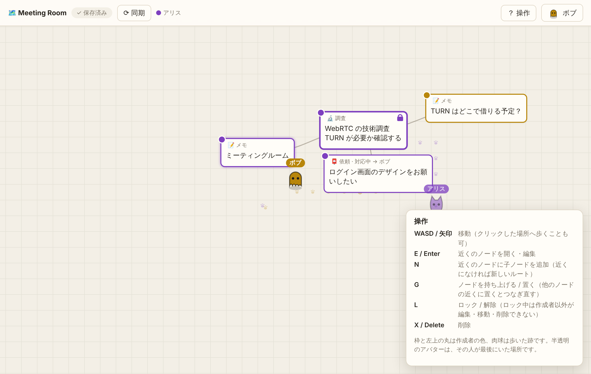

# meeting-room

マインドマップの世界を2Dゲームのように歩き回りながら、友人と **作業進捗・作業依頼・技術調査報告** を共有するバーチャルミーティングルームです。
データは **Google ドライブの共有フォルダ** に保存され、時間差で同期されます（サーバー不要）。

設計の詳細は [docs/design.md](docs/design.md) を参照してください。



## できること

- アバターで歩き回り、近くのノードを開く・追加する・持ち運んでつなぎ直す
- ユーザーごとの表示名、テーマカラー、アバター、ひとことステータス
- ノードの作成者を色で表示（左上の丸と枠線）
- ロック：作成者以外の編集・移動・削除を禁止（子ノードの追加は可）
- 足跡：歩いた場所に自分の色の肉球が残り、時間とともに薄くなる。他の人が最後にいた場所も表示
- ノードの種類：メモ / 進捗 / 依頼（担当者・状態つき）/ 調査
- 前回の訪問以降に他の人が更新したノードに NEW を表示

## 操作

| キー | 動作 |
|---|---|
| WASD / 矢印 | 移動（クリックした場所へ歩くことも可） |
| E / Enter | 近くのノードを開く・編集（ダブルクリックでも可） |
| N | 近くのノードに子ノードを追加（近くになければ新しいルート） |
| G | ノードを持ち上げる / 置く（他のノードに近づけて置くと、その子になる） |
| L | ロック / 解除 |
| X / Delete | 削除 |

## ローカルで試す（Google 不要）

```bash
npm install
npm run dev
```

- http://localhost:5173/?mode=local&user=alice
- http://localhost:5173/?mode=local&user=bob

同じブラウザの別タブで開くと、localStorage を共有フォルダに見立てて2人分の動作を試せます。

## Google ドライブで友人と使う

### 1. Google Cloud の設定

1. [Google Cloud Console](https://console.cloud.google.com/) でプロジェクトを作成する
2. 「API とサービス」→「ライブラリ」で **Google Drive API** を有効にする
3. 「OAuth 同意画面」を設定する
   - ユーザーの種類：**外部**
   - 公開ステータス：**テスト** のままにする
   - スコープ：`openid`、`.../auth/userinfo.profile`、`.../auth/drive`
   - **テストユーザー** に自分と友人の Google アカウントを追加する（最大100人）
4. 「認証情報」→「OAuth クライアント ID を作成」→ **ウェブアプリケーション**
   - 承認済みの JavaScript 生成元：`http://localhost:5173` と公開先（例：`https://<ユーザー名>.github.io`）

### 2. 共有フォルダ

1. Google ドライブにフォルダを作り、友人を **編集者** として共有する
2. フォルダの URL（`https://drive.google.com/drive/folders/<ID>`）を控えておく

### 3. 起動

```bash
cp .env.example .env.local   # VITE_GOOGLE_CLIENT_ID を記入
npm run dev
```

ログイン画面で共有フォルダの URL か ID を入力し、Google でログインします。

### テストモードでの注意

- 「このアプリは Google で確認されていません」と表示されます。「詳細」→「（安全ではないページ）に移動」で進んでください
- アクセストークンは約1時間で切れます。切れると画面上部に「再ログイン」ボタンが出ます
- テストユーザーに登録していないアカウントはログインできません

### 公開（GitHub Pages など）

```bash
VITE_BASE=/meeting-room/ VITE_GOOGLE_CLIENT_ID=... npm run build
```

`dist/` を静的ホスティングに置き、その URL を OAuth クライアントの「承認済みの JavaScript 生成元」に追加してください。

## 開発

```bash
npm test          # ユニットテスト（同期・ロック・循環解消・足跡）
npm run build     # 型チェック + ビルド
```

## 構成

```
src/
  auth/      Google ログイン（GIS トークン方式）、開発用のローカルセッション
  storage/   共有フォルダの抽象化（Drive / localStorage / メモリ）
  sync/      Yjs 差分ファイルによる時間差同期
  model/     マインドマップのデータモデル（ロック・循環解消）、足跡
  game/      Canvas 描画、移動とキー操作、アバター
  ui/        ダイアログ、パレット
```
